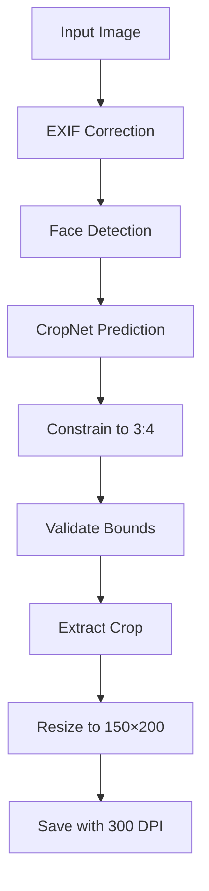

# Portrait Crop System — Implementation Plan

## Overview

Upgrade the AI Crop Trainer from a generic crop-box regressor to a **portrait-specific cropping system** that:

1. Detects faces via a replaceable `FaceDetector` interface
2. Uses CropNet to learn preferred framing from training examples
3. Constrains all crops to **3:4 aspect ratio** (width/height = 0.75)
4. Exports final images at **150 × 200 px** with **300 DPI** metadata



---

## Current State (What Exists)

| Component | File | Status |
|-----------|------|--------|
| CropNet model | `ml/model.py` | Outputs `[x, y, w, h]` normalized — **unconstrained aspect ratio** |
| Inference | `ml/inference.py` | Calls `predict_with_validation` — **no face detection, no AR constraint** |
| Export | `backend/api/model.py:export_crop` | Saves raw crop — **no resize, no DPI** |
| CropEditor | `frontend/src/components/CropEditor.tsx` | Free-form drag — **no aspect ratio lock** |
| Training labels | `backend/api/dataset.py` | No aspect ratio validation |
| Image service | `backend/services/image_service.py` | `crop_image` returns raw crop — **no resize** |
| Settings | `backend/config/settings.py` | No portrait output constants |

---

## Phase 1 — Configuration Constants

**Files to modify:** [`settings.py`](file:///Users/akhilpt/Downloads/image_crop_ml/backend/config/settings.py)

Add portrait output constants:

```python
# Portrait crop output
PORTRAIT_ASPECT_RATIO = 3 / 4          # width / height = 0.75
PORTRAIT_OUTPUT_WIDTH = 150            # px
PORTRAIT_OUTPUT_HEIGHT = 200           # px
PORTRAIT_OUTPUT_DPI = (300, 300)       # metadata only
ASPECT_RATIO_TOLERANCE = 0.03         # ±3% tolerance for validation
```

> [!NOTE]
> These are configuration-level, not hardcoded throughout the codebase. All code references these constants.

---

## Phase 2 — Face Detector Interface + MediaPipe Implementation

**New files to create:**

| File | Purpose |
|------|---------|
| `ml/face_detector.py` | Abstract `FaceDetector` interface + `MediaPipeFaceDetector` implementation |

### Interface Design

```python
@dataclass
class FaceDetection:
    x: int          # absolute pixel coords in original image
    y: int
    width: int
    height: int
    confidence: float
    landmarks: dict | None = None   # optional: eyes, nose, etc.

class FaceDetector(ABC):
    @abstractmethod
    def detect(self, image: Image.Image) -> list[FaceDetection]:
        """Detect faces in an image. Returns list sorted by confidence desc."""

class MediaPipeFaceDetector(FaceDetector):
    """MediaPipe-based face detector. Lightweight, runs on CPU/M2."""
```

### Why MediaPipe?
- Runs natively on macOS / M2
- No CUDA dependency
- Single pip install: `pip install mediapipe`
- Includes face detection + face mesh (landmarks)
- Can be swapped for RetinaFace/SCRFD later via the interface

### Fallback Behavior
- If no face detected → fall back to CropNet-only prediction
- If multiple faces → use the largest / highest confidence
- Face detection is **informational input** to the pipeline, not a hard gate

**Dependencies to install:** `mediapipe`

---

## Phase 3 — Aspect Ratio Constraint in CropNet

**Files to modify:** [`ml/model.py`](file:///Users/akhilpt/Downloads/image_crop_ml/ml/model.py)

### Approach: Post-prediction constraint (not architectural change)

The CropNet model continues to output `[x, y, width, height]` normalized. A **post-processing function** constrains the output to 3:4:

```python
def constrain_to_aspect_ratio(
    pred: torch.Tensor,       # [B, 4]: x, y, w, h
    aspect_ratio: float = 0.75,  # w/h
) -> torch.Tensor:
    """Constrain predicted crop to target aspect ratio."""
    x, y, w, h = pred[:, 0], pred[:, 1], pred[:, 2], pred[:, 3]
    
    # Adjust width to match target AR based on predicted height
    # OR adjust height based on predicted width — pick the one that fits
    target_w = h * aspect_ratio
    target_h = w / aspect_ratio
    
    # Use whichever produces a smaller crop (safer — stays in bounds)
    use_height = target_w <= w  # can we shrink width to fit?
    new_w = torch.where(use_height, target_w, w)
    new_h = torch.where(use_height, h, target_h)
    
    # Re-center the crop
    new_x = x + (w - new_w) / 2
    new_y = y + (h - new_h) / 2
    
    # Clamp to [0, 1]
    new_x = torch.clamp(new_x, 0.0, 1.0 - new_w)
    new_y = torch.clamp(new_y, 0.0, 1.0 - new_h)
    
    return torch.stack([new_x, new_y, new_w, new_h], dim=1)
```

### What changes:
- Add `constrain_to_aspect_ratio()` function to `ml/model.py`
- Update `predict_with_validation()` to apply the constraint
- The raw `forward()` remains unconstrained (for loss computation during training)

### What does NOT change:
- CropNet architecture (4 outputs, sigmoid)
- Training loss function (predicts unconstrained, loss drives it toward 3:4 labels)
- Backbone registry

> [!IMPORTANT]
> The model naturally learns 3:4 because all training labels have 3:4 aspect ratio. The post-processing constraint is a safety net, not the primary mechanism.

---

## Phase 4 — Training Data Validation

**Files to modify:** [`backend/api/dataset.py`](file:///Users/akhilpt/Downloads/image_crop_ml/backend/api/dataset.py)

### Add aspect ratio validation during upload:

When a training pair is uploaded:

1. Extract crop rectangle (existing logic)
2. **Validate** that `crop_width / crop_height ≈ 0.75` within tolerance
3. If valid → `status = "labeled"`
4. If invalid AR → `status = "pending"`, add note `"Invalid aspect ratio: {actual}. Expected ≈ 0.75"`

### Target image dimension check:

The target image itself doesn't need to be 150×200. Valid target dimensions include:
- 150 × 200 (1×)
- 300 × 400 (2×)  
- 450 × 600 (3×)
- 750 × 1000 (5×)
- Any dimensions where `w/h ≈ 0.75`

**What changes:**
- Add `validate_aspect_ratio()` helper
- Call it in `upload_training_pair()` after crop extraction
- Add validation result to `notes` field

---

## Phase 5 — Inference Pipeline Upgrade

**Files to modify:** [`ml/inference.py`](file:///Users/akhilpt/Downloads/image_crop_ml/ml/inference.py), [`backend/api/model.py`](file:///Users/akhilpt/Downloads/image_crop_ml/backend/api/model.py)

### Updated inference flow:

```python
def predict_portrait_crop(
    image_path: str,
    model_path: str,
    image_size: int = 224,
    backbone: str = "mobilenet_v3_small",
) -> dict:
    # 1. Load image with EXIF correction
    # 2. Run face detection
    # 3. Run CropNet prediction
    # 4. Constrain to 3:4
    # 5. Validate bounds
    # 6. Return: {x, y, width, height, face_box, confidence}
```

### Face detection integration:

The face detection result is returned alongside the crop prediction for display purposes. The CropNet model handles the actual framing decision. If a face is detected, it provides useful context.

**New return fields:**
```python
{
    "x": float, "y": float, "width": float, "height": float,
    "face_detected": bool,
    "face_box": {"x": int, "y": int, "width": int, "height": int} | None,
    "face_confidence": float | None,
    "aspect_ratio": float,  # should be ≈ 0.75
}
```

---

## Phase 6 — Export Pipeline (150×200 + 300 DPI)

**Files to modify:** [`backend/services/image_service.py`](file:///Users/akhilpt/Downloads/image_crop_ml/backend/services/image_service.py), [`backend/api/model.py`](file:///Users/akhilpt/Downloads/image_crop_ml/backend/api/model.py)

### New function in `image_service.py`:

```python
def export_portrait_crop(
    image_path: Path,
    x: int, y: int, width: int, height: int,
    output_path: Path,
    target_width: int = 150,
    target_height: int = 200,
    dpi: tuple = (300, 300),
) -> Path:
    """Extract crop, resize to target dimensions, save with DPI metadata."""
    with Image.open(image_path) as img:
        img = fix_exif_orientation(img)
        if img.mode != "RGB":
            img = img.convert("RGB")
        
        cropped = img.crop((x, y, x + width, y + height))
        resized = cropped.resize((target_width, target_height), Image.LANCZOS)
        resized.save(output_path, quality=95, dpi=dpi)
    
    return output_path
```

### Update `export_crop` endpoint:
- Use `export_portrait_crop` instead of `crop_image`
- Return `{"width": 150, "height": 200, "dpi": 300}` in response

> [!IMPORTANT]
> `Image.resize()` with LANCZOS preserves quality. Since the crop is already 3:4 and the output is 3:4 (150/200 = 0.75), there is **no distortion**.

---

## Phase 7 — Frontend Updates

### 7a. CropEditor — Locked Aspect Ratio

**File:** [`CropEditor.tsx`](file:///Users/akhilpt/Downloads/image_crop_ml/frontend/src/components/CropEditor.tsx)

Add `aspectRatio?: number` prop. When set:
- Dragging any edge/corner maintains the ratio
- Moving the crop freely is still allowed
- Width changes → height adjusts proportionally (and vice versa)

```typescript
interface Props {
  // ...existing
  aspectRatio?: number;  // e.g., 0.75 for 3:4
}
```

### 7b. TestPage / CropPage — Face Box + Output Info

**Files:** [`TestPage.tsx`](file:///Users/akhilpt/Downloads/image_crop_ml/frontend/src/pages/TestPage.tsx), [`CropPage.tsx`](file:///Users/akhilpt/Downloads/image_crop_ml/frontend/src/pages/CropPage.tsx)

Show:
- **Face detection box** (dashed green rectangle)
- **Predicted crop box** (solid blue rectangle, 3:4)
- **Output info**: `150 × 200 px · 300 DPI · 3:4`
- **Final crop preview** thumbnail

### 7c. API Types

**File:** [`types.ts`](file:///Users/akhilpt/Downloads/image_crop_ml/frontend/src/types.ts)

Add face detection fields to `PredictionResponse`:
```typescript
face_detected: boolean;
face_box_x: number | null;
face_box_y: number | null;
face_box_width: number | null;
face_box_height: number | null;
```

---

## Phase 8 — Tests

**New test file:** `tests/test_portrait_crop.py`

| Test | Purpose |
|------|---------|
| `test_aspect_ratio_constraint_exact` | `constrain_to_aspect_ratio` produces exactly 0.75 |
| `test_aspect_ratio_constraint_bounds` | Constrained crop stays within [0,1] |
| `test_aspect_ratio_constraint_batch` | Works on batch of predictions |
| `test_face_detector_interface` | Abstract interface is callable |
| `test_mediapipe_detector_synthetic` | Detects face in synthetic portrait image |
| `test_face_detection_no_face` | Returns empty list for non-face image |
| `test_face_detection_multiple` | Returns sorted by confidence |
| `test_export_dimensions` | Output is exactly 150×200 |
| `test_export_dpi` | Output has 300×300 DPI in EXIF |
| `test_export_no_distortion` | Aspect ratio is preserved (no stretch) |
| `test_training_label_ar_validation` | Valid 3:4 target passes |
| `test_training_label_bad_ar` | Non-3:4 target flagged |
| `test_crop_editor_locked_ar` | Frontend constraint logic |
| `test_inference_pipeline_full` | End-to-end: image → face → crop → 3:4 → export |
| `test_fallback_no_face` | System works without face detection |

**Constraint:** All 69 existing tests must continue passing.

---

## Execution Order

| Phase | Description | Dependencies | Est. Effort |
|-------|-------------|-------------|-------------|
| **1** | Settings constants | None | 5 min |
| **2** | FaceDetector interface + MediaPipe | Phase 1, `pip install mediapipe` | 30 min |
| **3** | AR constraint in CropNet | Phase 1 | 15 min |
| **4** | Training data AR validation | Phase 1 | 15 min |
| **5** | Inference pipeline upgrade | Phase 2, 3 | 30 min |
| **6** | Export pipeline (150×200 + DPI) | Phase 1 | 15 min |
| **7** | Frontend (CropEditor lock, face box, output info) | Phase 5, 6 | 45 min |
| **8** | Tests | All phases | 30 min |

**Total estimated: ~3 hours**

---

## Files Summary

### Modified (existing)
| File | Changes |
|------|---------|
| `backend/config/settings.py` | Portrait constants |
| `ml/model.py` | `constrain_to_aspect_ratio()` function |
| `ml/inference.py` | `predict_portrait_crop()`, face detection integration |
| `backend/api/model.py` | Updated predict/export endpoints, face box in response |
| `backend/api/dataset.py` | AR validation on upload |
| `backend/schemas/api_schemas.py` | Face box fields in `PredictionResponse` |
| `backend/services/image_service.py` | `export_portrait_crop()` function |
| `frontend/src/components/CropEditor.tsx` | `aspectRatio` prop, locked drag |
| `frontend/src/pages/TestPage.tsx` | Face box overlay, output info |
| `frontend/src/pages/CropPage.tsx` | Face box overlay, output info |
| `frontend/src/types.ts` | Face detection fields |

### New
| File | Purpose |
|------|---------|
| `ml/face_detector.py` | `FaceDetector` ABC + `MediaPipeFaceDetector` |
| `tests/test_portrait_crop.py` | 15+ tests for all new functionality |

### Not Modified (preserved as-is)
| File | Reason |
|------|--------|
| `ml/dataset.py` | No change — labels are still `[x, y, w, h]` normalized |
| `ml/train.py` | No change — loss function unchanged |
| `ml/preprocessing.py` | No change — image preprocessing unchanged |
| `ml/metrics.py` | No change — IoU/MAE still valid |
| `backend/services/crop_extractor.py` | No change — template matching still extracts the rectangle |
| `tests/test_pipeline_audit.py` | No change — all 36 tests preserved |
| `tests/test_metrics.py` | No change — all 10 tests preserved |
| `tests/test_batch_upload.py` | No change — all 23 tests preserved |
